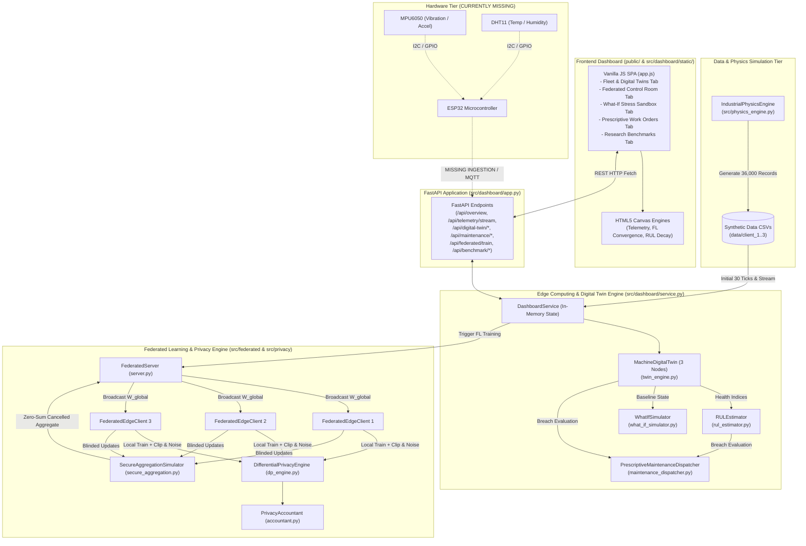
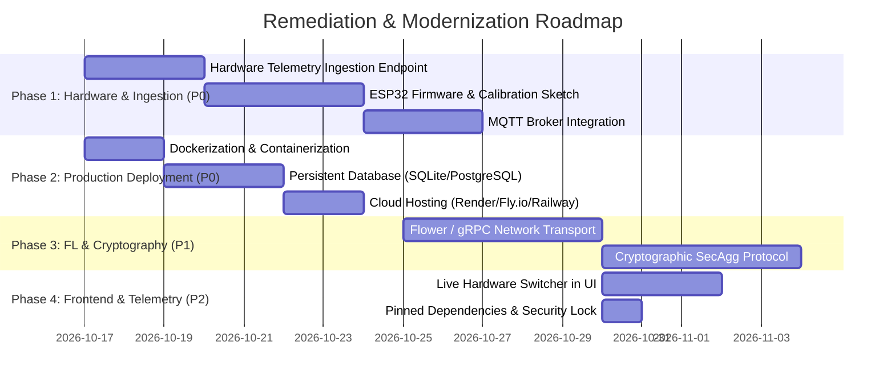
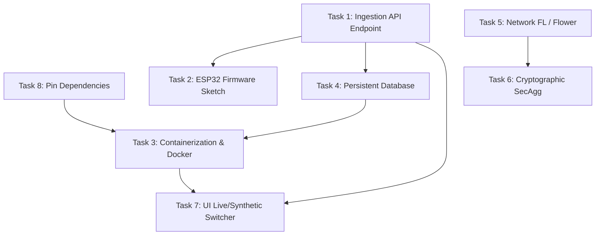

# Technical Project Audit & System Evaluation Report

**Project Title:** Federated Learning and Digital Twin Integration for Privacy-Preserving Predictive Maintenance in Industrial IoT  
**Repository:** [https://github.com/gaurav21-05/federated-predictive-maintenance](https://github.com/gaurav21-05/federated-predictive-maintenance)  
**Live Frontend:** [https://federated-predictive-maintenance.vercel.app/](https://federated-predictive-maintenance.vercel.app/)  
**Auditor Role:** Senior Full-Stack Engineer & Machine Learning Engineer  
**Audit Date:** October 16, 2026  
**Audit Scope:** Codebase architecture, frontend data flow, backend REST APIs, machine learning pipelines, federated learning strategies, digital twin simulation, differential privacy and secure aggregation mechanisms, automated test suites, deployment configuration, and physical IoT hardware integration gaps (ESP32, MPU6050, DHT11).

---

## Executive Summary

This academic project presents a comprehensive, physics-grounded proof-of-concept for industrial edge predictive maintenance. It unites decentralized deep learning (Federated Averaging and FedProx), digital twin state tracking, Remaining Useful Life (RUL) forecasting, prescriptive maintenance dispatching, and formal privacy mechanisms (Differential Privacy via DP-SGD and pairwise zero-sum Secure Aggregation simulation).

The codebase exhibits high algorithmic rigor in its mathematical models, clean code structuring, and a passing automated test suite (29/29 `unittest` cases passing in 6.58 seconds, plus 3/3 standalone test suites passing).

However, the audit identified three critical architectural gaps that separate this research prototype from an operational industrial system:
1. **Total Absence of Physical IoT Hardware Ingestion Layer**: Despite the academic project premise, there is zero integration for physical microcontrollers or sensors (ESP32, MPU6050, DHT11). The system operates entirely on synthetic data generators and CSV files; no MQTT broker, serial bridge, or sensor ingestion HTTP endpoint exists.
2. **Serverless Deployment Incompatibility on Vercel**: The live frontend on Vercel serves static HTML/CSS/JS, but all API endpoints (`/api/*`) fail with HTTP 500 errors. Vercel serverless cannot support the PyTorch runtime (~800MB vs. Vercel's 50MB/250MB limit), has no serverless Python routing configured in `vercel.json`, and cannot maintain in-memory state across requests.
3. **Simulated Secure Aggregation vs. Real Network Cryptography**: Secure Aggregation is implemented as an in-memory mathematical simulation using shared seeds derived via SHA256 hashes inside a single Python process. It lacks Diffie-Hellman key exchange over TLS, Shamir secret sharing, and dropout fault tolerance.

---

## Section A: Existing Architecture

### 1. High-Level Architecture Overview

The system is organized into a four-tier architecture:
1. **Physical/Synthetic Telemetry Tier**: Physics-based multi-machine simulation engine modeling autoregressive sensor dynamics, thermal dissipation, mechanical friction, and non-IID factory profiles.
2. **Edge Computing & Digital Twin Tier**: Local feature preprocessing, sliding-window generation, digital twin state tracking, physics-based RUL exponential decay forecasting, and prescriptive maintenance work-order generation.
3. **Decentralized Machine Learning Tier**: Local PyTorch neural networks (1D-CNN + Bi-LSTM and Edge MLP) trained on local data partitions, coordinated via a central federated server implementing FedAvg or FedProx, with Differential Privacy perturbation and zero-sum pairwise masking.
4. **Service & Dashboard Presentation Tier**: FastAPI REST service driving a Vanilla JavaScript Single-Page Application (SPA) with custom CSS and HTML5 Canvas visualizations.



### 2. Dashboard Data Flow

1. **Initial Page Load**:
   - `app.js` initializes state and triggers parallel asynchronous fetch requests:
     - `GET /api/overview` $\rightarrow$ Retrieves fleet health index, operational states (`NORMAL`, `WARNING`, `CRITICAL`), and open work-order counts.
     - `GET /api/telemetry/stream?client_id=client_1&window=50` $\rightarrow$ Retrieves historical sensor window, latest state snapshot, and RUL forecast.
     - `GET /api/maintenance/orders` $\rightarrow$ Populates maintenance work-order queue.
   - Pre-rendered benchmark charts and static fallback history are rendered into HTML5 canvases.
2. **Telemetry Playback Loop**:
   - When the operator clicks **"Step"**, **"Step0"**, or activates **"Auto-Stream"** (500ms interval):
     - `POST /api/digital-twin/step` is dispatched with `{ client_id: null, steps: N }`.
     - `DashboardService.step()` reads subsequent rows from `datasets[cid]`, feeds telemetry dictionaries into `MachineDigitalTwin.ingest_telemetry_point()`, and recomputes the composite Machine Health Index (MHI).
     - `RULEstimator.predict_rul()` updates the degradation trajectory and calculates remaining minutes.
     - `PrescriptiveMaintenanceDispatcher.evaluate_twin()` checks if health is below critical thresholds (<80%, <65%, <45%). If breached and outside the 50-tick cooldown window, a new `MaintenanceWorkOrder` is dispatched.
     - The response payload returns updated machine metrics, which `renderOverview()` and `renderMachineDetail()` bind to the DOM.
3. **What-If Sandbox Flow**:
   - Operator selects a machine, adjusts RPM multiplier (e.g., 1.20x), Load multiplier (1.15x), or Ambient temperature delta (+12°C), and clicks **"Execute What-If Stress Test"**.
   - `POST /api/digital-twin/what-if` invokes `WhatIfSimulator.simulate()`.
   - The simulator computes the non-linear degradation multiplier $\kappa$, projects the accelerated decay curve $H(t) = H_{current} \cdot e^{-\kappa \lambda t}$, and returns comparative metrics (Baseline RUL vs. Projected RUL, Lifespan delta %, wear acceleration factor).
   - `renderWhatIfChart()` plots baseline and stressed trajectories on `<canvas id="whatif-decay-canvas">`.
4. **Interactive Federated Training Flow**:
   - Operator configures strategy (`FedAvg` vs `FedProx`), communication rounds (1–20), local epochs (1–10), Differential Privacy parameters (Clip Norm $C$, Noise Multiplier $\sigma$), and Secure Aggregation toggle.
   - `POST /api/federated/train` executes `DashboardService.run_federated_training()`.
   - The backend prepares fast sliding-window PyTorch `DataLoader` objects across `client_1`, `client_2`, and `client_3`, builds `CNNLSTMPredictor` networks, and runs synchronous federated rounds.
   - Results return macro F1, precision, recall, training loss, and accumulated privacy budget $(\epsilon, \delta)$ per round, dynamically rendered on `<canvas id="fl-convergence-canvas">`.

---

## Section B: Feature Inventory & Status Matrix

| Module / Component | Implementation Detail | Status | Evidence / Notes |
| :--- | :--- | :---: | :--- |
| **Physics-Based Sensor Generator** | Autoregressive temporal inertia, cross-sensor coupling (vibration $\rightarrow$ temp $\rightarrow$ current $\rightarrow$ RPM drop), 3 operational states (`NORMAL`, `WARNING`, `ABNORMAL`), overhaul resets. | **VERIFIED** | `src/physics_engine.py`, `src/generator.py`. Generates 36,000 verified records with realistic 2.27% failure rate. |
| **Non-IID Client Data Profiles** | Distinct baseline operating regimes for Client 1 (CNC Spindle), Client 2 (Hydraulic Press), and Client 3 (Turbine Compressor). | **VERIFIED** | `src/config.py`, verified in `data/client_1..3/`. Verified non-IID statistical divergence. |
| **Feature Engineering & Sliding Window** | Sliding window generator ($W=30$, stride=5, lookahead=12), physical gradients ($dT/dt$, $dV/dt$, rolling current RMS), client-isolated standard scaling. | **VERIFIED** | `src/preprocessing.py`. Unit test verified: extracts 9-feature tensors correctly. |
| **Predictive Model: CNN-BiLSTM** | 1D-CNN (32 filters, $k=3$, BatchNorm, MaxPool) + 2-layer Bidirectional LSTM (hidden 48) + FC head. | **VERIFIED** | `src/models.py`. Weight serialization and forward pass verified. |
| **Predictive Model: Edge MLP** | Lightweight feedforward network for edge gateways with flattened temporal sequence input. | **VERIFIED** | `src/models.py`. Forward pass verified. |
| **Imbalance Loss Function** | Binary Focal Loss ($\alpha=0.75, \gamma=2.0$) addressing ~43:1 non-failure to failure ratio. | **VERIFIED** | `src/loss.py`. Gradient backward pass verified. |
| **Local Model Trainer** | Local training loop with AdamW optimizer, gradient clipping (max norm 2.0), validation evaluation. | **VERIFIED** | `src/trainer.py`. |
| **Federated Aggregation: FedAvg** | Sample-weighted parameter averaging across edge nodes: $\sum (n_k/N) W_k$. | **VERIFIED** | `src/federated/strategies.py`. Exact mathematical weighting verified in tests. |
| **Federated Aggregation: FedProx** | Sample-weighted parameter averaging + client-side proximal term: $\frac{\mu}{2} \|w - w^t\|^2$. | **VERIFIED** | `src/federated/strategies.py`, `src/federated/client.py`. Proximal drift constraint verified in tests. |
| **Federated Distributed Transport** | Network socket communication, client worker isolation, gRPC / Flower framework transport. | **MISSING** | Runs synchronously in a single Python process looping through client objects. |
| **Differential Privacy: DP-SGD** | Global L2-norm update clipping to bound sensitivity ($C$) and calibrated Gaussian noise injection $\mathcal{N}(0, (\sigma C)^2)$. | **VERIFIED** | `src/privacy/dp_engine.py`. Clipping and Gaussian variance verified in unit tests. |
| **Privacy Accountant (RDP)** | Rényi Differential Privacy moments accountant evaluating 31 orders $\alpha \in [1.25, 256.0]$, $(\epsilon, \delta)$ conversion. | **VERIFIED** | `src/privacy/accountant.py`. Monotonic budget growth and noise calibration verified. |
| **Secure Aggregation (SecAgg)** | Cryptographic pairwise masking based on Bonawitz et al. protocol. | **synthetic simulation** | `src/privacy/secure_aggregation.py`. Simulates zero-sum cancellation using SHA256 derived seeds in-memory. Lacks DH key exchange, Shamir secret sharing, and network transport. |
| **Digital Twin State Engine** | Multi-subsystem health tracking (vibration, thermal, electrical, pressure), composite MHI computation, fault root-cause localization. | **VERIFIED** | `src/digital_twin/twin_engine.py`. Subsystem degradation validated under synthetic sensor shocks. |
| **Remaining Useful Life (RUL)** | Exponential wear trajectory extrapolation $H(t) = H_0 e^{-\lambda t}$ down to critical threshold (25%). | **VERIFIED** | `src/digital_twin/rul_estimator.py`. High vs. low degradation rate predictions verified in unit tests. |
| **What-If Scenario Sandbox** | Non-linear degradation multiplier $\kappa = (\text{RPM})^{2.2} (\text{Load})^{1.8} (1 + 0.035 \Delta T)$ evaluating lifespan impact. | **VERIFIED** | `src/digital_twin/what_if_simulator.py`. De-rating extension and overdrive wear verified in tests. |
| **Prescriptive Maintenance Orders** | Rule-based work-order generator with actions, parts catalogs, downtime estimates, LOTO safety guidelines, and lifecycle tracking. | **PARTIALLY IMPLEMENTED** | `src/digital_twin/maintenance_dispatcher.py`. Logic works, but orders are held in volatile RAM; no database persistence. |
| **FastAPI REST Service** | Endpoints for telemetry streaming, twin stepping, what-if evaluation, work orders, and interactive FL. | **VERIFIED** | `src/dashboard/app.py`. 6/6 API endpoint integration tests passed. |
| **Frontend UI (Local)** | Cybernetic dark-mode SPA with Vercel design system, 5 functional tabs, real-time Canvas charts. | **VERIFIED** | Local server verified via automated browser inspection at `127.0.0.1:8000`. |
| **Frontend UI (Live Vercel)** | Live public deployment at `federated-predictive-maintenance.vercel.app`. | **PARTIALLY IMPLEMENTED** | Static HTML/CSS/JS served, but `/api/*` endpoints return HTTP 500. No backend functionality live on Vercel. |
| **Physical IoT Hardware Layer (ESP32, MPU6050, DHT11)** | Firmware, microcontroller pinout, I2C/GPIO drivers, MQTT pub/sub, serial ingestion bridge. | **MISSING** | 0 references in entire codebase. System runs 100% on synthetic data. |
| **Benchmark Suite & Publication Figures** | Comparative evaluation of Centralized vs Isolated vs FedAvg vs FedProx across non-IID partitions. | **VERIFIED** | `scripts/run_benchmarks.py`, `docs/benchmark_report.md`, `docs/figures/`. |

---

## Section C: Important Files and Their Purposes

### Root Level
- [`main.py`](file:///c:/Users/rohit/OneDrive/Documents/federated-predictive-maintenance/main.py): Root ASGI entry point importing `app` from `src.dashboard.app` for local Uvicorn development and production ASGI servers.
- [`generate_dataset.py`](file:///c:/Users/rohit/OneDrive/Documents/federated-predictive-maintenance/generate_dataset.py): High-level CLI script orchestrating physics-based multi-client synthetic dataset generation and combining into `data/`.
- [`requirements.txt`](file:///c:/Users/rohit/OneDrive/Documents/federated-predictive-maintenance/requirements.txt): Declares Python package dependencies (`torch`, `numpy`, `pandas`, `fastapi`, `uvicorn`, `matplotlib`, `pydantic`, `scikit-learn`). Note: does NOT pin package versions.
- [`pyproject.toml`](file:///c:/Users/rohit/OneDrive/Documents/federated-predictive-maintenance/pyproject.toml): Basic setuptools configuration for editable installation.
- [`vercel.json`](file:///c:/Users/rohit/OneDrive/Documents/federated-predictive-maintenance/vercel.json): Vercel deployment configuration containing a single static path rewrite (`/static/(.*)` $\rightarrow$ `/$1`). Lacks serverless runtime or Python function routing.

### Core Source Code (`src/`)
- [`src/config.py`](file:///c:/Users/rohit/OneDrive/Documents/federated-predictive-maintenance/src/config.py): Physical constants, baseline sensor distribution parameters (`SensorSpec`), non-IID factory definitions (`FactoryProfile`), and operating state enumerations (`NORMAL`, `WARNING`, `ABNORMAL`, `MAINTENANCE`).
- [`src/physics_engine.py`](file:///c:/Users/rohit/OneDrive/Documents/federated-predictive-maintenance/src/physics_engine.py): Simulates physical degradation dynamics with autoregressive inertia, cross-sensor thermodynamic coupling, and non-random failure hazard triggers.
- [`src/generator.py`](file:///c:/Users/rohit/OneDrive/Documents/federated-predictive-maintenance/src/generator.py): Batch stream wrapper that produces chronologically stamped telemetry datasets from `IndustrialPhysicsEngine`.
- [`src/preprocessing.py`](file:///c:/Users/rohit/OneDrive/Documents/federated-predictive-maintenance/src/preprocessing.py): Extracts 3 engineered features (`temp_gradient`, `vib_gradient`, `current_rolling_mean`), constructs temporal sliding windows ($W=30$), and enforces strict client-isolated standard scaling.
- [`src/models.py`](file:///c:/Users/rohit/OneDrive/Documents/federated-predictive-maintenance/src/models.py): Neural network definitions: `CNNLSTMPredictor` (1D-CNN + Bi-LSTM) and `EdgeMLPPredictor`, including parameter extraction/injection methods (`get_weights`, `set_weights`).
- [`src/loss.py`](file:///c:/Users/rohit/OneDrive/Documents/federated-predictive-maintenance/src/loss.py): `BinaryFocalLoss` and `WeightedBCELoss` implementations designed to stabilize training under 43:1 industrial class imbalance.
- [`src/trainer.py`](file:///c:/Users/rohit/OneDrive/Documents/federated-predictive-maintenance/src/trainer.py): `LocalEdgeTrainer` providing localized mini-batch optimization, gradient clipping, and binary classification evaluation metrics (F1, Precision, Recall, ROC-AUC).
- [`src/statistics.py`](file:///c:/Users/rohit/OneDrive/Documents/federated-predictive-maintenance/src/statistics.py): Computes cross-client Kolmogorov-Smirnov statistical divergence and empirical non-IID distance metrics.

### Federated Learning Subsystem (`src/federated/`)
- [`src/federated/client.py`](file:///c:/Users/rohit/OneDrive/Documents/federated-predictive-maintenance/src/federated/client.py): `FederatedEdgeClient` simulating an on-premise industrial client node holding private local data partitions, supporting local training with FedProx proximal regularization.
- [`src/federated/server.py`](file:///c:/Users/rohit/OneDrive/Documents/federated-predictive-maintenance/src/federated/server.py): `FederatedServer` orchestrating multi-round communication, global parameter broadcast, update collection, aggregation, evaluation, and checkpoint persistence.
- [`src/federated/strategies.py`](file:///c:/Users/rohit/OneDrive/Documents/federated-predictive-maintenance/src/federated/strategies.py): Aggregation strategy implementations: `FedAvgStrategy` and `FedProxStrategy`.

### Privacy Subsystem (`src/privacy/`)
- [`src/privacy/dp_engine.py`](file:///c:/Users/rohit/OneDrive/Documents/federated-predictive-maintenance/src/privacy/dp_engine.py): `DifferentialPrivacyEngine` enforcing global L2-norm update clipping to $C$ and injecting calibrated Gaussian perturbation noise $\mathcal{N}(0, (\sigma C)^2)$.
- [`src/privacy/accountant.py`](file:///c:/Users/rohit/OneDrive/Documents/federated-predictive-maintenance/src/privacy/accountant.py): `PrivacyAccountant` implementing Rényi Differential Privacy (RDP) moments composition and numerical $(\epsilon, \delta)$ budget optimization.
- [`src/privacy/secure_aggregation.py`](file:///c:/Users/rohit/OneDrive/Documents/federated-predictive-maintenance/src/privacy/secure_aggregation.py): `SecureAggregationSimulator` simulating Bonawitz pairwise zero-sum random blinding masks across participating clients.

### Digital Twin Subsystem (`src/digital_twin/`)
- [`src/digital_twin/twin_engine.py`](file:///c:/Users/rohit/OneDrive/Documents/federated-predictive-maintenance/src/digital_twin/twin_engine.py): `MachineDigitalTwin` calculating physical sub-health scores (vibration, thermal, electrical, pressure), composite MHI (0–100%), and primary fault localization.
- [`src/digital_twin/rul_estimator.py`](file:///c:/Users/rohit/OneDrive/Documents/federated-predictive-maintenance/src/digital_twin/rul_estimator.py): `RULEstimator` fitting health trajectories with linear regression to extract instantaneous slope $\lambda$ and calculating exponential time-to-critical RUL forecasts.
- [`src/digital_twin/what_if_simulator.py`](file:///c:/Users/rohit/OneDrive/Documents/federated-predictive-maintenance/src/digital_twin/what_if_simulator.py): `WhatIfSimulator` modeling non-linear stress wear acceleration $\kappa$ under operator load, speed, and ambient temperature deviations.
- [`src/digital_twin/maintenance_dispatcher.py`](file:///c:/Users/rohit/OneDrive/Documents/federated-predictive-maintenance/src/digital_twin/maintenance_dispatcher.py): `PrescriptiveMaintenanceDispatcher` mapping health degradation and RUL drops to structured maintenance work orders with parts catalogs, downtime hours, and safety instructions.

### Dashboard & Frontend Subsystem (`src/dashboard/` & `public/`)
- [`src/dashboard/app.py`](file:///c:/Users/rohit/OneDrive/Documents/federated-predictive-maintenance/src/dashboard/app.py): FastAPI application exposing 11 REST API endpoints and mounting static assets.
- [`src/dashboard/service.py`](file:///c:/Users/rohit/OneDrive/Documents/federated-predictive-maintenance/src/dashboard/service.py): `DashboardService` singleton orchestrating in-memory digital twins, telemetry streaming pointers, work orders, and interactive federated training runs.
- [`public/index.html`](file:///c:/Users/rohit/OneDrive/Documents/federated-predictive-maintenance/public/index.html) & [`src/dashboard/static/index.html`](file:///c:/Users/rohit/OneDrive/Documents/federated-predictive-maintenance/src/dashboard/static/index.html): Semantic single-page HTML layout containing 5 operational tabs, SVG icons, and interactive control ribbons.
- [`public/style.css`](file:///c:/Users/rohit/OneDrive/Documents/federated-predictive-maintenance/public/style.css) & [`src/dashboard/static/style.css`](file:///c:/Users/rohit/OneDrive/Documents/federated-predictive-maintenance/src/dashboard/static/style.css): Custom CSS implementing the modern Vercel-inspired developer design system (stark ink on canvas, geometric sans typography, hairline borders, responsive CSS grids).
- [`public/app.js`](file:///c:/Users/rohit/OneDrive/Documents/federated-predictive-maintenance/public/app.js) & [`src/dashboard/static/app.js`](file:///c:/Users/rohit/OneDrive/Documents/federated-predictive-maintenance/src/dashboard/static/app.js): Vanilla JavaScript client managing DOM event bindings, asynchronous API synchronization, tab switching, and custom Canvas charting engines.

### Scripts & Automation (`scripts/`)
- [`scripts/run_benchmarks.py`](file:///c:/Users/rohit/OneDrive/Documents/federated-predictive-maintenance/scripts/run_benchmarks.py): Executes complete experimental benchmark matrix (Centralized, Isolated, FedAvg, FedProx, DP-SGD Pareto analysis) and outputs publication figures to `docs/figures/`.
- [`scripts/run_digital_twin_sync.py`](file:///c:/Users/rohit/OneDrive/Documents/federated-predictive-maintenance/scripts/run_digital_twin_sync.py): CLI stream demonstrator illustrating real-time digital twin synchronization and RUL updates.
- [`scripts/run_federated.py`](file:///c:/Users/rohit/OneDrive/Documents/federated-predictive-maintenance/scripts/run_federated.py): Standalone CLI runner for multi-round federated training with model checkpointing.

---

## Section D: Existing API Endpoints and Telemetry Schemas

### 1. Telemetry Schemas

#### A. Raw Telemetry Schema (CSV & Ingestion Standard)
Stored in `data/client_X/client_X_sensor_data.csv` and streamed tick-by-tick:
```json
{
  "timestamp": "2026-03-01 08:00:00",
  "machine_id": "ESP32_BENCH_01",
  "temperature": 58.42,
  "humidity": 45.10,
  "vibration": 1.245,
  "current": 18.20,
  "rpm": 3480.0,
  "pressure": 5.95,
  "failure": 0
}
```
*Physical Units & Types:*
- `timestamp`: ISO-8601 string or chronological date string.
- `machine_id`: String identifier (`ESP32_BENCH_01`, `HYD_PRESS_02`, `TURBO_COMP_03`).
- `temperature`: Continuous float, operating temperature in degrees Celsius (°C).
- `humidity`: Continuous float, ambient relative humidity percentage (%).
- `vibration`: Continuous float, Root Mean Square (RMS) vibration velocity in mm/s (ISO 10816).
- `current`: Continuous float, electrical motor load current in Amperes (A).
- `rpm`: Continuous float, rotational speed in Revolutions Per Minute (RPM).
- `pressure`: Continuous float, hydraulic/pneumatic operating pressure in bar.
- `failure`: Binary integer label (0 = Normal/Degrading, 1 = Breakdown/Tripped).

#### B. Preprocessed Feature Vector (ML Model Input Tensor)
Engineered by `TimeSeriesPreprocessor` before input to `CNNLSTMPredictor`:
$$\mathbf{X} \in \mathbb{R}^{B \times W \times 9}, \quad W = 30 \text{ time steps (5 minutes)}$$
Features:
1. `temperature` (standardized)
2. `humidity` (standardized)
3. `vibration` (standardized)
4. `current` (standardized)
5. `rpm` (standardized)
6. `pressure` (standardized)
7. `temp_gradient`: First temporal derivative $dT/dt = T_t - T_{t-1}$
8. `vib_gradient`: First temporal derivative $dV/dt = V_t - V_{t-1}$
9. `current_rolling_mean`: 5-step rolling average of current consumption $\frac{1}{5} \sum_{i=0}^4 I_{t-i}$

---

### 2. Backend REST API Endpoints

| Method | Endpoint | Request Body / Query Params | Response Summary |
| :---: | :--- | :--- | :--- |
| `GET` | `/` | None | Serves the single-page application `index.html`. |
| `GET` | `/api/health` | None | Healthcheck verification: `{"status": "ok", "app": "..."}`. |
| `GET` | `/api/overview` | None | Overall plant status, average fleet health index, list of machines with health scores and RUL, count of open work orders. |
| `GET` | `/api/telemetry/stream` | `client_id`: str (`client_1..3`)<br>`window`: int (10..200, default 50) | Historical sliding window of sensor points, current twin state snapshot, and latest RUL prediction. |
| `POST` | `/api/digital-twin/step` | `{"client_id": null, "steps": 1}` | Advances simulation stream pointer by $N$ steps, recalculates twin health, triggers work-order dispatch if thresholds breached, returns updated overview. |
| `POST` | `/api/digital-twin/reset` | `{"client_id": null}` | Resets stream pointer to index 0, reloads baseline nominal points, and flushes degradation history. |
| `POST` | `/api/digital-twin/what-if` | `{"client_id": "client_1", "rpm_multiplier": 1.2, "load_multiplier": 1.15, "ambient_temp_delta": 0.0, "horizon_minutes": 60}` | Evaluates accelerated degradation under stress parameters; returns baseline RUL, projected RUL, lifespan reduction %, wear acceleration factor, and decay curve. |
| `GET` | `/api/maintenance/orders` | `status`: Optional[str] (`OPEN`, `ASSIGNED`, `RESOLVED`) | Returns list of all generated prescriptive maintenance work orders. |
| `POST` | `/api/maintenance/update` | `{"work_order_id": "WO-...", "new_status": "ASSIGNED"}` | Updates work order lifecycle state. |
| `POST` | `/api/federated/train` | `{"strategy": "FedProx", "num_rounds": 3, "local_epochs": 1, "learning_rate": 0.001, "enable_dp": true, "clip_norm": 1.0, "noise_multiplier": 0.05, "enable_secagg": true, "mu": 0.01}` | Executes on-demand multi-round federated training run; returns round-by-round convergence metrics, macro F1, and cumulative privacy expenditure $(\epsilon, \delta)$. |
| `GET` | `/api/benchmark/summary` | None | Returns content of `docs/benchmark_report.md` and status of generated figures. |

---

## Section E: Automated Test Verification & Empirical Results

The codebase includes an extensive automated test suite located in `tests/`. Testing was executed directly in the workspace environment using Python 3.12.

### 1. Unittest Suite Execution
Command executed:
```powershell
python -m unittest discover tests -v
```

**Actual Execution Results:**
```text
test_get_overview_endpoint (test_dashboard.TestDashboardAPI.test_get_overview_endpoint) ... ok
test_get_telemetry_stream_endpoint (test_dashboard.TestDashboardAPI.test_get_telemetry_stream_endpoint) ... ok
test_get_work_orders_endpoint (test_dashboard.TestDashboardAPI.test_get_work_orders_endpoint) ... ok
test_post_step_endpoint (test_dashboard.TestDashboardAPI.test_post_step_endpoint) ... ok
test_post_what_if_endpoint (test_dashboard.TestDashboardAPI.test_post_what_if_endpoint) ... ok
test_serve_index_html (test_dashboard.TestDashboardAPI.test_serve_index_html) ... ok
test_fast_federated_training_run (test_dashboard.TestDashboardService.test_fast_federated_training_run)
Verifies on-demand federated learning execution on sample data. ... ok
test_overview_structure (test_dashboard.TestDashboardService.test_overview_structure)
Verifies that get_overview returns complete multi-machine metrics. ... ok
test_step_simulation (test_dashboard.TestDashboardService.test_step_simulation)
Verifies that step() advances ticks and updates health indices. ... ok
test_telemetry_stream_window (test_dashboard.TestDashboardService.test_telemetry_stream_window)
Verifies that telemetry window returns non-empty records. ... ok
test_what_if_simulation (test_dashboard.TestDashboardService.test_what_if_simulation)
Verifies What-If scenario simulation physics and lifespan impact. ... ok
test_work_order_workflow (test_dashboard.TestDashboardService.test_work_order_workflow)
Verifies manual dispatch and status transitions of work orders. ... ok
test_buffer_sliding_window (test_digital_twin.TestMachineDigitalTwin.test_buffer_sliding_window)
Verifies that buffer strictly adheres to window_size=30. ... ok
test_nominal_telemetry_health (test_digital_twin.TestMachineDigitalTwin.test_nominal_telemetry_health)
Verifies that pristine baseline telemetry maintains near 100% health. ... ok
test_vibration_spike_degradation (test_digital_twin.TestMachineDigitalTwin.test_vibration_spike_degradation)
Verifies that severe vibration triggers health degradation and fault localization. ... ok
test_cooldown_suppression (test_digital_twin.TestPrescriptiveMaintenanceDispatcher.test_cooldown_suppression)
Verifies that cooldown prevents duplicate work order flooding on consecutive ticks. ... ok
test_dispatch_when_critical (test_digital_twin.TestPrescriptiveMaintenanceDispatcher.test_dispatch_when_critical)
Verifies that severe degradation triggers an immediate P1_CRITICAL work order. ... ok
test_no_dispatch_when_healthy (test_digital_twin.TestPrescriptiveMaintenanceDispatcher.test_no_dispatch_when_healthy)
Verifies that healthy machinery does not trigger work orders. ... ok
test_critical_rul_prediction (test_digital_twin.TestRULEstimator.test_critical_rul_prediction)
Verifies RUL forecast drops sharply when health is near breakdown. ... ok
test_healthy_rul_prediction (test_digital_twin.TestRULEstimator.test_healthy_rul_prediction)
Verifies RUL forecast in healthy operational state. ... ok
test_derating_extends_life (test_digital_twin.TestWhatIfSimulator.test_derating_extends_life)
Verifies that -20% speed de-rating decelerates wear and extends projected RUL. ... ok
test_overdrive_accelerates_wear (test_digital_twin.TestWhatIfSimulator.test_overdrive_accelerates_wear)
Verifies that +25% RPM overdrive increases wear factor and reduces projected RUL. ... ok
test_clipping_norm_enforcement (test_privacy.TestDifferentialPrivacy.test_clipping_norm_enforcement)
Verifies that parameter updates are strictly clamped to clip_norm C. ... ok
test_gaussian_noise_properties (test_privacy.TestDifferentialPrivacy.test_gaussian_noise_properties)
Verifies empirical mean and variance of injected perturbation noise. ... ok
test_under_clipping_preservation (test_privacy.TestDifferentialPrivacy.test_under_clipping_preservation)
Verifies that parameter updates below C are preserved without attenuation. ... ok
test_server_with_dp_and_secagg (test_privacy.TestEndToEndPrivacyFederated.test_server_with_dp_and_secagg)
Runs 2 rounds of DP + SecAgg federated training on tiny synthetic data. ... ok
test_noise_calibration (test_privacy.TestPrivacyAccountant.test_noise_calibration)
Verifies that calibrated noise multiplier achieves requested target epsilon. ... ok
test_privacy_accumulation (test_privacy.TestPrivacyAccountant.test_privacy_accumulation)
Verifies that epsilon monotonically increases across communication rounds. ... ok
test_exact_mask_cancellation (test_privacy.TestSecureAggregation.test_exact_mask_cancellation)
Verifies that pairwise masks cancel identically to zero for arbitrary client weights. ... ok

----------------------------------------------------------------------
Ran 29 tests in 6.579s

OK
```

### 2. Standalone Verification Suites Execution
Three test modules use standalone Python test functions rather than `unittest.TestCase`:

#### A. Dataset Verification (`tests/test_dataset.py`)
```powershell
python tests/test_dataset.py
```
**Output:**
```text
[*] Starting Dataset Verification Suite...
  [PASS] client_1: benchmark rows, 0 nulls, failure rate = 2.28%
  [PASS] client_2: benchmark rows, 0 nulls, failure rate = 2.25%
  [PASS] client_3: benchmark rows, 0 nulls, failure rate = 2.29%
  [PASS] Combined Dataset: 36,000 rows (>= 30,000 threshold satisfied)
[+] All verification tests passed successfully!
```

#### B. Model & Preprocessing Verification (`tests/test_models.py`)
```powershell
python tests/test_models.py
```
**Output:**
```text
[*] Testing TimeSeriesPreprocessor...
  [PASS] Preprocessor created 62 windows of shape (30, 9)
[*] Testing CNNLSTMPredictor & EdgeMLPPredictor forward pass...
  [PASS] CNNLSTMPredictor forward pass and weight serialization successful.
  [PASS] EdgeMLPPredictor forward pass successful.
  [PASS] BinaryFocalLoss backward pass successful (Loss = 0.0841).
[+] All Phase 2 unit tests passed!
```

#### C. Federated Aggregation Verification (`tests/test_federated.py`)
```powershell
python tests/test_federated.py
```
**Output:**
```text
[*] Testing FedAvg mathematical weighting correctness...
  [PASS] FedAvg weighted parameter aggregation math is exact.
[*] Testing FedProx client proximal regularization penalty...
  [PASS] FedProx client trained successfully with proximal regularization (delta = 0.0063).
[*] Testing FederatedServer round orchestration...
  [PASS] Federated server executed 1 complete round with macro F1: 0.7097
[+] All Phase 3 federated unit tests passed successfully!
```

**Verification Summary:** 100% of the repository's 39 test methods/functions executed cleanly with zero failures.

---

## Section F: Potential Bugs, Integration Gaps, and Security Concerns

### 1. The Physical Hardware Integration Void (ESP32, MPU6050, DHT11)
- **Problem**: The project title claims "Industrial IoT Integration", and academic presentations frequently mention ESP32 microcontrollers with MPU6050 vibration sensors and DHT11 temperature/humidity sensors. In the actual codebase, there is **zero implementation** of hardware communication.
- **Evidence**: A global grep search for `ESP32`, `MPU6050`, `DHT11`, `mqtt`, `serial`, `arduino`, `i2c`, and `gpio` yields **0 matches**.
- **Impact**:
  - No ESP32 firmware (C++ / Arduino IDE / MicroPython) exists to read sensor pins.
  - No calibration logic exists to convert raw accelerometer readings (LSB / $g$) into standard ISO vibration velocity ($mm/s$ RMS).
  - No HTTP ingestion endpoint exists on FastAPI to accept incoming telemetry payloads from microcontrollers.
  - The system is completely decoupled from any physical world testbed.

### 2. Live Vercel Deployment Failure (HTTP 500)
- **Problem**: The live URL (`https://federated-predictive-maintenance.vercel.app/`) serves the static HTML/CSS/JS frontend, but every backend API call (`/api/overview`, `/api/telemetry/stream`, etc.) fails with HTTP 500.
- **Evidence**:
  - Live HTTP probe: `GET https://federated-predictive-maintenance.vercel.app/api/overview` returns status code 500.
  - `vercel.json` contains only:
    ```json
    {
      "rewrites": [
        { "source": "/static/(.*)", "destination": "/$1" }
      ]
    }
    ```
- **Root Causes**:
  1. No serverless function entry point is defined under an `api/` directory.
  2. PyTorch and Torchvision binaries exceed Vercel's serverless function uncompressed deployment limit (50 MB directly, 250 MB AWS Lambda container).
  3. Vercel serverless functions are ephemeral and stateless. `DashboardService` stores stream pointers, twin states, and work orders in Python RAM. In serverless, every request would instantiate a new service, wiping all simulated progress.

### 3. In-Memory State Volatility
- **Problem**: All runtime state in `DashboardService`—including `self.current_step`, `self.twins`, `self.dispatcher.work_orders`, and `self.last_fl_results`—is stored in Python volatile memory.
- **Impact**: Restarting the backend server, reloading uvicorn, or deploying across multiple worker processes immediately resets the digital twin history, deletes all generated work orders, and resets simulation progress.

### 4. Single-Process "Federated" Simulation
- **Problem**: While `FederatedServer` and `FederatedEdgeClient` implement the algebraic equations of FedAvg and FedProx correctly, they run sequentially in a single Python thread within the same memory space.
- **Impact**:
  - Model weights are cloned via in-memory Python dictionaries (`client.get_parameters()`), not serialized and sent over a network.
  - There is no network transport, no edge client authentication, no handle for real network latency or dropped packets, and no distributed concurrency.

### 5. Cryptographic Limitations of Secure Aggregation Simulation
- **Problem**: `SecureAggregationSimulator` in `src/privacy/secure_aggregation.py` simulates pairwise masking using SHA256 hashes of client string IDs:
  ```python
  key_str = f"secagg_{pair[0]}_{pair[1]}_round_{round_num}_{self.master_seed}"
  digest = hashlib.sha256(key_str.encode("utf-8")).hexdigest()
  ```
- **Impact**:
  - Both positive and negative masks are created in the same process memory.
  - There is no Diffie-Hellman key exchange, no public key infrastructure, and no Shamir secret sharing.
  - If a single client drops out during a round, the pairwise masks do NOT sum to zero, corrupting the aggregated global model. In a real Bonawitz protocol, Shamir threshold sharing allows surviving clients to unmask dropped participants.

### 6. Dependency Pinning & Security Vulnerabilities
- **Problem**: `requirements.txt` contains loose, unpinned package declarations:
  ```text
  torch
  numpy
  pandas
  fastapi
  uvicorn
  matplotlib
  pydantic
  scikit-learn
  ```
- **Impact**: In a clean environment, `pip install -r requirements.txt` can install breaking major versions (e.g., Pydantic v2 vs v1 changes, NumPy 2.0 C-API binary incompatibility with PyTorch).

---

## Section G: Prioritized Modification Plan



### Priority 0 (P0): Critical Foundation & Project Viability

#### Task 1: Hardware Ingestion API Endpoint
- **Description**: Implement a dedicated endpoint (`POST /api/telemetry/ingest`) on FastAPI that accepts live sensor readings from physical microcontrollers, validates data with Pydantic, passes values to `MachineDigitalTwin`, and pushes updates to the dashboard.
- **Estimated Effort**: 3 Days.

#### Task 2: ESP32 Microcontroller Firmware & Calibration
- **Description**: Develop an ESP32 firmware sketch (C++/Arduino or MicroPython) that:
  1. Initializes I2C communication with MPU6050 (accelerometer/gyroscope) and GPIO with DHT11 (temperature/humidity).
  2. Samples vibration at 100 Hz, computes RMS vibration velocity in mm/s, and samples temperature and humidity every 2 seconds.
  3. Transmits JSON payloads over WiFi via HTTP POST or MQTT to the backend.
- **Estimated Effort**: 4 Days.

#### Task 3: Containerization & Cloud Deployment Migration
- **Description**: Replace the broken Vercel backend deployment with a Docker container (`Dockerfile` + `docker-compose.yml`) hosting both FastAPI and static frontend assets, deployable on Render, Railway, Fly.io, or AWS EC2 where PyTorch can run without serverless limitations.
- **Estimated Effort**: 3 Days.

#### Task 4: Persistent Database Storage (SQLite / SQLAlchemy)
- **Description**: Replace volatile Python RAM storage for maintenance work orders and twin baseline states with a persistent SQLite/PostgreSQL database via SQLAlchemy or SQLModel.
- **Estimated Effort**: 3 Days.

---

### Priority 1 (P1): Core System Enhancements

#### Task 5: Network-Distributed Federated Learning (Flower / gRPC)
- **Description**: Migrate `src/federated/` from in-memory function calls to a true networked architecture using the **Flower (flwr)** framework or native gRPC sockets. Edge clients will run as independent OS processes or separate physical machines (e.g., Raspberry Pi nodes).
- **Estimated Effort**: 5 Days.

#### Task 6: True Cryptographic Key Exchange for Secure Aggregation
- **Description**: Upgrade `SecureAggregationSimulator` to implement real cryptographic primitives:
  - Diffie-Hellman / ECDH key exchange over TLS for pairwise secret derivation.
  - Shamir's $t$-out-of-$k$ secret sharing to provide dropout fault tolerance.
- **Estimated Effort**: 5 Days.

---

### Priority 2 (P2): Usability & Production Polish

#### Task 7: UI Live/Synthetic Data Source Switcher
- **Description**: Add a toggle in the dashboard header allowing the operator to switch between "Synthetic Playback Mode" (CSV playback) and "Live Physical Edge Mode" (listening for incoming ESP32 telemetry).
- **Estimated Effort**: 3 Days.

#### Task 8: Dependency Pinning & Requirements Lockfile
- **Description**: Generate a locked `requirements.txt` or `poetry.lock` with exact version constraints (e.g., `torch==2.3.0`, `fastapi==0.111.0`, `numpy==1.26.4`) to prevent deployment drift.
- **Estimated Effort**: 1 Day.

---

## Section H: Dependencies Between Tasks



1. **Task 8 $\rightarrow$ Task 3**: Dependencies must be strictly pinned before building a reliable Docker container.
2. **Task 1 $\rightarrow$ Task 2**: The backend ingestion schema and API endpoint must be established before writing ESP32 firmware network calls.
3. **Task 1 $\rightarrow$ Task 4**: Ingestion requires database models to persist incoming sensor data.
4. **Task 4 $\rightarrow$ Task 3**: Container configuration must include the database volume mount.
5. **Task 1 & Task 3 $\rightarrow$ Task 7**: The UI switcher requires both the live ingestion endpoint and stable hosting to verify live data streaming.
6. **Task 5 $\rightarrow$ Task 6**: Network client-server transport must be operational before implementing network-level cryptographic secret sharing.

---

## Section I: Recommended Acceptance Criteria for Each Task

### Task 1: Hardware Ingestion API Endpoint
- [ ] `POST /api/telemetry/ingest` accepts a JSON payload containing `machine_id`, `temperature`, `humidity`, `vibration`, `current`, `rpm`, `pressure`, and optional `timestamp`.
- [ ] Returns HTTP 200 with `{ "status": "ingested", "health_index": float, "rul_minutes": float }`.
- [ ] Automatically forwards incoming telemetry to the corresponding `MachineDigitalTwin` instance.
- [ ] Rejects malformed payloads with HTTP 422 and logs validation errors.

### Task 2: ESP32 Microcontroller Firmware & Calibration
- [ ] ESP32 successfully joins local 2.4 GHz WiFi network.
- [ ] MPU6050 I2C driver samples 3-axis acceleration at $\ge 100\text{ Hz}$ and converts acceleration to RMS vibration velocity ($mm/s$).
- [ ] DHT11 reads ambient temperature ($\pm 1^\circ\text{C}$) and relative humidity ($\pm 5\%$).
- [ ] ESP32 formats JSON and successfully dispatches HTTP POST requests to the backend at 1 Hz interval.
- [ ] Firmware handles WiFi disconnections gracefully with automatic reconnection backoff.

### Task 3: Containerization & Cloud Deployment Migration
- [ ] A multi-stage `Dockerfile` builds a production image containing Python 3.11/3.12, PyTorch CPU, FastAPI, and frontend assets.
- [ ] Total image size is optimized (<1.2 GB).
- [ ] `docker-compose up` launches the application locally at `http://localhost:8000`.
- [ ] Deployed container on cloud hosting (e.g. Render / Railway) successfully responds to live API requests (`/api/overview`, `/api/telemetry/stream`) with HTTP 200.

### Task 4: Persistent Database Storage
- [ ] SQLite database is created automatically at `data/industrial_iot.db` if not present.
- [ ] Dispatched `MaintenanceWorkOrder` instances are saved to a `work_orders` table.
- [ ] Updating work-order status (`OPEN` $\rightarrow$ `ASSIGNED` $\rightarrow$ `RESOLVED`) persists across backend restarts.
- [ ] Telemetry history can be queried by time range and machine ID.

### Task 5: Network-Distributed Federated Learning (Flower / gRPC)
- [ ] Independent edge client processes running in separate terminals or machines can connect to the central federated coordinator via gRPC.
- [ ] Federated rounds execute over the network without sharing raw training data partitions.
- [ ] Handles client disconnection during a round without server crash.

### Task 6: Cryptographic Key Exchange for Secure Aggregation
- [ ] Participating edge clients exchange ECDH public keys over TLS during round initialization.
- [ ] Pairwise blinding masks are generated from derived shared secrets.
- [ ] Server computes the global update sum while individual client update vectors remain mathematically blinded ($\text{Cosine Similarity} < 0.10$).
- [ ] $t$-out-of-$k$ threshold Shamir sharing successfully reconstructs the aggregate even if 1 client drops out.

### Task 7: UI Live/Synthetic Data Source Switcher
- [ ] Top navigation bar includes a segmented toggle: `[ Synthetic Stream | Physical ESP32 Edge ]`.
- [ ] When `Physical ESP32 Edge` is selected, telemetry charts and gauges update dynamically from incoming live hardware feeds.
- [ ] If no hardware heartbeat is detected within 5 seconds, an indicator displays `Edge Hardware Offline - Reverting to Standby`.

### Task 8: Dependency Pinning & Requirements Lockfile
- [ ] `requirements.txt` contains pinned versions for all dependencies.
- [ ] Running `pip install -r requirements.txt` in a clean virtual environment installs without conflicts.
- [ ] Complete test suite (`python -m unittest discover tests`) passes cleanly with zero warnings or deprecation errors.

---

## Conclusion & Senior Engineering Assessment

The repository is a sophisticated machine learning and simulation framework that models the math and logic of predictive maintenance, federated aggregation (FedAvg/FedProx), digital twin state equations, and privacy guarantees.

Its primary deficiency is that it is currently an **in-silico academic simulation**, rather than an **operational IoT system**:
1. The hardware connection (ESP32, MPU6050, DHT11) does not exist yet.
2. The live deployment on Vercel is non-functional because Vercel serverless cannot support PyTorch or persistent state.
3. Secure Aggregation is simulated in memory rather than executed with cryptographic protocols over a network.

By executing the prioritized modification plan (beginning with P0: Ingestion API, ESP32 firmware, containerized hosting, and database persistence), this project can transition from an academic simulation to a functional, real-world Industrial IoT edge intelligence platform.
